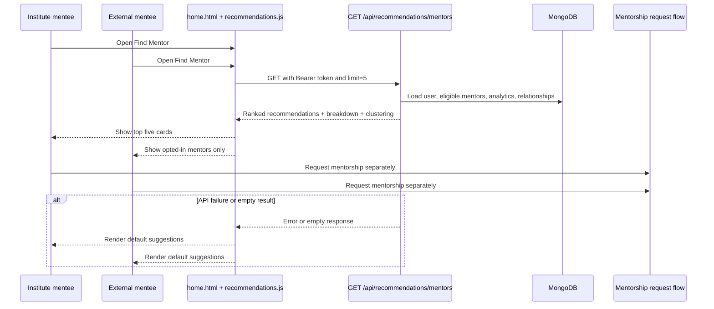
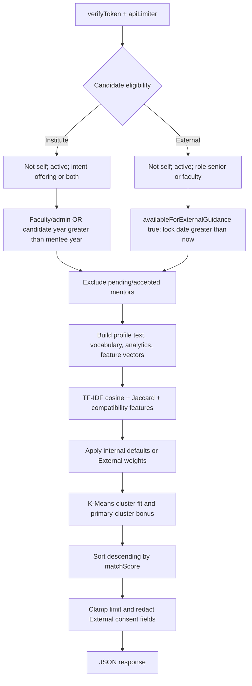

# Mentor recommendation engine

> **Future-phase rule:** Every recommendation-engine change must, in the same PR, append an Evolution-log entry, update the affected sections, and record before/after ranking evidence.

**Purpose:** Living record of the current mentor and peer recommendation implementations.  
**Last updated:** 2026-10-13  
**Status:** ✅ Live (documentation snapshot; implementation includes known flaws)  
**Engine version:** `v0 (baseline snapshot)`  
**Baseline commit:** `cdf5e96004a4ff77d56b7f745aa6c57d81975b82` [source: repository `git rev-parse HEAD`; status: VERIFIED-RUN]

## 1. Overview

- The active mentor route returns ranked mentor candidates for an authenticated user. [source: `routes/recommendations.js:117-171`; status: VERIFIED-CODE]
- It filters candidates by activity, mentorship intent, role/year eligibility, existing relationships, and (for External users) explicit guidance opt-in. [source: `routes/recommendations.js:24-52,129-164`; status: VERIFIED-CODE]
- It combines profile fields, TF-IDF text similarity, hand-set compatibility terms, analytics, and K-Means cluster fit. [source: `utils/recommendationEngine.js:387-480,531-692`; status: VERIFIED-CODE]
- It is **not a trained ML model**; it is a rule-filtered, TF-IDF + weighted-scoring + K-Means hybrid. [source: `utils/recommendationEngine.js:89-128,270-349,387-480`; status: VERIFIED-CODE]
- The implementation returns score components and cluster metadata intended for UI explanations. [source: `utils/recommendationEngine.js:647-692`; status: VERIFIED-CODE]
- A separate peer matcher exists and is not the mentor engine documented by the main dashboard flow. [source: `routes/users.js:1293-1365`, `recommender_model/src/peerMatcher.js:75-187`; status: VERIFIED-CODE]

## 2. User flow

### Institute mentee

1. The user opens **Find Mentor** from the home page. [source: `public/home.html:2480-2488,5378-5389`; status: VERIFIED-CODE]
2. The page requests the mentor endpoint and asks for five results. [source: `public/js/recommendations.js:13-32,501-512`; status: VERIFIED-CODE]
3. The page shows ranked cards with the mentor name, role/department/year line, compatibility score, and profile information rendered by the recommendation UI. [source: `public/js/recommendations.js:527-627`; status: VERIFIED-CODE]
4. Hovering, focusing, or tapping a card expands its breakdown; displayed metrics include skill match, profile match, mentor quality, activity, profile, department, and schedule when present. [source: `public/js/recommendations.js:55-76,145-172`; status: VERIFIED-CODE]
5. The recommendation itself does not create a mentorship request; the user must use the existing mentorship flow to request one. [source: `public/js/recommendations.js:527-627`, `models/Mentorship.js:3-74`; status: VERIFIED-CODE]
6. If the request has no token, returns a non-2xx response, returns no recommendations, or throws, the browser renders default suggestions or returns the fetch result as null. [source: `public/js/recommendations.js:14-18,33-47,501-505,688-754`; status: VERIFIED-CODE]

### External-user variant

1. The same mentor endpoint is used, but the candidate query is restricted to active senior/faculty users who opted into External guidance and whose lock date is still in the future. [source: `routes/recommendations.js:37-52,140-145`; status: VERIFIED-CODE]
2. The `User` model stores the opt-in and academic-year lock fields; the schema default for opt-in is false. [source: `models/User.js:184-205`; status: VERIFIED-CODE]
3. The route removes External guidance consent fields from each recommendation and explanation before responding. [source: `routes/recommendations.js:167-179,253-270`; status: VERIFIED-CODE]
4. The code does not independently require an External mentee to have a year or department after the External candidate query; missing academic fields therefore remain possible inputs to scoring. [source: `routes/recommendations.js:129-164`, `utils/recommendationEngine.js:387-480`; status: VERIFIED-CODE]



## 3. Technical flow

### Endpoints and parameters

| Endpoint | Parameters | Current behavior |
|---|---|---|
| `GET /api/recommendations/mentors` | `limit`: numeric, floored and clamped to 1–50; `department`: read into a local variable but not used in the query or scorer. | Authenticated, rate-limited mentor ranking. [source: `routes/recommendations.js:7-18,117-171`; status: VERIFIED-CODE] |
| `GET /api/recommendations/mentors/:mentorId/explain` | `mentorId` path parameter; no query parameter. | Recomputes one eligible mentor’s explanation using the same engine. [source: `routes/recommendations.js:184-287`; status: VERIFIED-CODE] |

### Pipeline



Eligibility and pipeline behavior are implemented in [source: `routes/recommendations.js:117-179`, `utils/recommendationEngine.js:531-692`; status: VERIFIED-CODE].

### Scoring components

The engine computes a normalized score, then returns component percentages. Internal weights are the explicit weights in `calculateCompatibilityBreakdown`; fixed terms are also part of the score. External weights replace only `skills`, `interests`, `availability`, and `goals`; the other fixed terms remain. [source: `utils/recommendationEngine.js:387-480`, `config/externalRecommendationWeights.js:1-6`; status: VERIFIED-CODE]

| Component | Formula/algorithm | Inputs | Range | Internal weight | External weight | Source |
|---|---|---|---:|---:|---:|---|
| Skill alignment | Jaccard intersection/union of mentee skills+interests and mentor skills+interests | `skills`, `interests` | 0–1 | 0.20 | 0.35 (`skills`) | `utils/recommendationEngine.js:jaccardSimilarity,calculateCompatibilityBreakdown` |
| Content similarity | Cosine similarity of TF-IDF vectors | skills, interests, bio, project title/description/technologies | 0–1 | 0.12 | 0.25 (`interests`) | `utils/recommendationEngine.js:buildProfileText,calculateTfIdf,cosineSimilarity` |
| Department match | Exact uppercase equality | `department` | 0 or 1 | 0.10 | 0.10 fixed | `utils/recommendationEngine.js:calculateCompatibilityBreakdown` |
| Academic progression | `clamp((mentor.year - mentee.year + 2) / 6, 0, 1)` | `year` | 0–1 | 0.10 | 0.10 fixed | `utils/recommendationEngine.js:calculateCompatibilityBreakdown` |
| Availability | Exact lower-case equality, otherwise 0.6 | `availability` | 0.6 or 1 | 0.08 | 0.15 (`availability`) | `utils/recommendationEngine.js:calculateCompatibilityBreakdown` |
| Mentor quality | `0.6 * avgSatisfaction/5 + 0.4 * completionRate`, clamped | interaction and mentorship aggregates | 0–1 | 0.18 (`goals`) | 0.25 (`goals`) | `utils/recommendationEngine.js:calculateCompatibilityBreakdown`, `routes/recommendations.js:55-103` |
| Activity signal | `0.5 * totalInteractions/60 + 0.5 * recencyScore`, clamped | interaction count and latest timestamp | 0–1 | 0.11 fixed | 0.11 fixed | `utils/recommendationEngine.js:calculateCompatibilityBreakdown` |
| Profile strength | Five binary fields at 20 points each, divided by 100 | picture, ≥3 skills, bio, projects, CGPA | 0–1 | 0.08 fixed | 0.08 fixed | `utils/recommendationEngine.js:profileStrength` |
| Cluster fit | `1 - normalized distance`, clamped | K-Means vector and assigned centroid | 0–1 | 0.03 fixed | 0.03 fixed | `utils/recommendationEngine.js:calculateCompatibilityBreakdown` |
| Cluster bonus | `0.05` if mentor is in the selected primary cluster | selected cluster assignment | 0 or 0.05 | 0.05 additive | 0.05 additive | `utils/recommendationEngine.js:calculateCompatibilityBreakdown` |

The weighted score is clamped to 0–1 and returned as `Math.round(finalScore * 100)`. [source: `utils/recommendationEngine.js:423-430`; status: VERIFIED-CODE]

### TF-IDF

- The corpus is one mentee profile document followed by one document for every eligible mentor. [source: `utils/recommendationEngine.js:587-590`; status: VERIFIED-CODE]
- Each document includes skills, interests, bio, and project title, description, and technologies. [source: `utils/recommendationEngine.js:40-70`; status: VERIFIED-CODE]
- Text is lowercased, URLs and underscores are replaced, non `[a-z0-9\s+.#/\-]` characters are replaced, whitespace is collapsed, tokens of length ≤1 and punctuation-only tokens are discarded, and duplicate profile tokens are removed by `buildProfileText`. [source: `utils/recommendationEngine.js:13-31,40-70`; status: VERIFIED-CODE]
- TF is term count divided by document length; IDF is `log((1 + documentCount) / (1 + documentFrequency)) + 1`; vectors use TF×IDF. [source: `utils/recommendationEngine.js:89-128`; status: VERIFIED-CODE]

### Jaccard and exact matching

- Skill alignment uses exact normalized string-set overlap; normalization lowercases, trims, removes empty values, and deduplicates, but does not alias, stem, or semantically expand terms. [source: `utils/recommendationEngine.js:1-11,370-385`; status: VERIFIED-CODE]
- Department matching is exact after uppercasing. [source: `utils/recommendationEngine.js:177-179,404`; status: VERIFIED-CODE]
- This makes `node.js` and `node` distinct skill/text tokens unless they appear identically after tokenization. [source: `utils/recommendationEngine.js:13-31,370-385`; status: INFERRED]

### K-Means

- K-Means++ selects the first centroid randomly and selects later centroids using squared-distance weighted random selection. [source: `utils/recommendationEngine.js:221-268`; status: VERIFIED-CODE]
- Fewer than three mentors produces one cluster; otherwise `k = clamp(round(sqrt(n / 2)), 2, min(6,n))`. [source: `utils/recommendationEngine.js:349-353,303-317`; status: VERIFIED-CODE]
- The implementation runs at most 35 iterations, recomputes means, and reinitializes empty clusters randomly. [source: `utils/recommendationEngine.js:270-347`; status: VERIFIED-CODE]
- The closest centroid to the mentee core vector is selected; mentors in that cluster receive a 0.05 bonus. [source: `utils/recommendationEngine.js:602-624,423-430`; status: VERIFIED-CODE]

### Data sources and models

| Source | Fields read for mentor ranking | Use |
|---|---|---|
| `User` | `_id`, `name`, `role`, `isActive`, `userType`, `mentorshipIntent`, `availableForExternalGuidance`, `externalGuidanceLockedUntil`, `year`, `department`, `skills`, `interests`, `bio`, `availability`, `projects`, `cgpa`, `profilePicture` | Eligibility, text/features, response mentor object, profile strength. [source: `models/User.js:1-250`, `routes/recommendations.js:117-164`; status: VERIFIED-CODE] |
| `Interaction` | `mentorId`, `satisfactionRating`, `subjectTag`, `timestamp`; schema also defines `confirmationStatus` | Total interactions, average rating, subject breadth, latest interaction. The aggregate does **not** filter `confirmationStatus`. [source: `models/Interaction.js:3-108`, `routes/recommendations.js:61-103`; status: VERIFIED-CODE] |
| `Mentorship` | `mentorId`, `status` | Pending/accepted exclusion and accepted/terminated completion analytics. [source: `models/Mentorship.js:3-74`, `routes/recommendations.js:53-59,24-35`; status: VERIFIED-CODE] |

Interaction statistics aggregate every matching `Interaction` document; `avgSatisfaction` uses `$avg`, `subjectBreadth` uses the size of the distinct `subjectTag` set, and `lastInteractionAt` uses `$max(timestamp)`. [source: `routes/recommendations.js:61-103`; status: VERIFIED-CODE]

### Response and privacy

The mentor response is:

```json
{
  "success": true,
  "count": 0,
  "recommendations": [
    {
      "mentor": {},
      "mentorAnalytics": {},
      "matchScore": 0,
      "scoreComponents": {},
      "sharedContentTokens": [],
      "contentExplanation": "",
      "cluster": {}
    }
  ],
  "clustering": {}
}
```

The exact nested mentor object is the selected User document minus `password`; the engine adds analytics, score components, shared tokens, explanation, and cluster fields. [source: `routes/recommendations.js:147-179`, `utils/recommendationEngine.js:647-692`; status: VERIFIED-CODE]

- The route explicitly removes `externalGuidanceLockedUntil`, `externalGuidanceTermsVersion`, `externalGuidanceTermsAcceptedAt`, and `termsVersion` from recommendation and explanation objects. [source: `routes/recommendations.js:167-179,253-270`; status: VERIFIED-CODE]
- `admissionInfo` is schema-level `select: false`; the recommendation queries do not explicitly select it. [source: `models/User.js:52-73`, `routes/recommendations.js:129-164`; status: VERIFIED-CODE]
- The code does not claim that every possible private field is redacted by the recommendation route; the documented guarantees are the explicit password/query and consent-field protections above. [source: `routes/recommendations.js:129-179,231-270`; status: VERIFIED-CODE]

### Frontend consumption and fallback

The static home page loads `/js/recommendations.js`, initializes recommendations when Find Mentor is opened and on page load, and exposes a Refresh matches button. [source: `public/home.html:5378-5389,9324-9332`; status: VERIFIED-CODE] The script calls the mentor endpoint with `limit=5`, maps `matchScore` and `scoreComponents`, renders cards, and falls back to default mentor cards for an empty/error result. [source: `public/js/recommendations.js:13-47,501-754`; status: VERIFIED-CODE]

### Separate peer engine

`GET /api/users/peers/recommendations` is a different system, not an alternate implementation of the main mentor endpoint. [source: `routes/users.js:1293-1365`; status: VERIFIED-CODE]

- It filters active users and optionally filters to the target department; it reads a 180-day interaction window. [source: `routes/users.js:1299-1331`; status: VERIFIED-CODE]
- It scores profile similarity, interest-to-skill complementarity, inferred reliability, availability, year/department context, and a reciprocal penalty. [source: `recommender_model/src/peerMatcher.js:1-187`; status: VERIFIED-CODE]
- Its defaults are profile 0.35, complementarity 0.20, reliability 0.25, availability 0.10, and context 0.10. [source: `recommender_model/src/peerMatcher.js:88-94`; status: VERIFIED-CODE]
- It returns `peers`, optionally with a breakdown, and metadata mode `peer_directional_v1`; the mentor engine returns `recommendations`, `matchScore`, TF-IDF/Jaccard components, and K-Means metadata. [source: `routes/users.js:1334-1365`, `utils/recommendationEngine.js:647-692`; status: VERIFIED-CODE]
- Both systems use exact normalized tokens, availability, academic context, and historical activity, but they use different formulas, fields, limits, eligibility rules, time windows, output names, and anti-gaming behavior. [source: `utils/recommendationEngine.js:387-480`, `recommender_model/src/peerMatcher.js:1-187`; status: VERIFIED-CODE]

## 4. Known flaws of v0 (baseline)

| # | Severity | Flaw | Impact on explainability/trust | Evidence |
|---:|---|---|---|---|
| 1 | High | K-Means++ and empty-cluster recovery use `Math.random()`. | The same inputs can receive different cluster assignments, cluster fit, bonus, and potentially ranking; explanations are not guaranteed stable. | `utils/recommendationEngine.js:221-268,303-347`; [status: VERIFIED-CODE] |
| 2 | High | External weights are added alongside fixed terms and a cluster bonus; the total can exceed 1 before clamping. | Scores can saturate at 100, hiding differences and overstating calibration. | `config/externalRecommendationWeights.js:1-6`, `utils/recommendationEngine.js:387-430`; [status: VERIFIED-CODE] |
| 3 | High | Interaction aggregation does not filter `confirmationStatus`. | Pending/unconfirmed interactions can influence activity, quality, breadth, and recency. | `models/Interaction.js:64-70`, `routes/recommendations.js:61-103`; [status: VERIFIED-CODE] |
| 4 | Medium | `department` request parameter is unused. | A caller can believe it requested department filtering when ranking behavior is unchanged. | `routes/recommendations.js:120-121,129-164`; [status: VERIFIED-CODE] |
| 5 | Medium | Python mentor-scoring fallback is dormant because `scripts/mentor_scoring.py` is absent in this snapshot. | The fallback cannot be selected; documentation or operational assumptions about Python scoring would be misleading. | `routes/users.js:23-24,436-440`; file absence inspected in repository; [status: VERIFIED-CODE] |
| 6 | Medium | The strong technical fixture assertion fails: `contentSimilarity < 60`. | The stated fixture expectation is not met; the first confidence signal in the verification script is false. | `verify-v2-recommendations.js:75-82`; safe run output below; [status: VERIFIED-RUN] |
| 7 | Medium | The failure above has not been demonstrated to be caused by K-Means randomness. | It would be incorrect to attribute the failed assertion to randomness without repeated controlled runs or a seeded comparison. | `verify-v2-recommendations.js:75-82`, `utils/recommendationEngine.js:221-268`; [status: VERIFIED-RUN] |
| 8 | Medium | The frontend Authorization header is visibly malformed (`Authorization: \`******`) even though Node syntax check accepts the file. | Browser requests may send an unintended header value; `node --check` does not prove runtime request correctness. | `public/js/recommendations.js:26-31`; safe syntax check result below; [status: VERIFIED-CODE] |
| 9 | Medium | Skill and token matching is exact after basic normalization; no aliases or stemming are applied. | Equivalent concepts with different spellings can score as unrelated, weakening reason quality. | `utils/recommendationEngine.js:1-31,370-385`; [status: VERIFIED-CODE] |
| 10 | Medium | TF-IDF is fit on the current mentee plus current eligible mentor corpus. | Small or changing candidate pools change IDF and similarity; scores are not comparable across requests or cohorts. | `utils/recommendationEngine.js:587-590`; [status: VERIFIED-CODE] |
| 11 | Medium | Missing numeric/profile fields fall back to zero in several features. | Sparse profiles can receive low quality/activity/content values without a missing-data explanation. | `utils/recommendationEngine.js:1-7,145-158,387-430`; [status: VERIFIED-CODE] |
| 12 | Medium | Activity and quality signals reward interaction volume and recency without a cap beyond normalization. | Existing high-volume mentors can receive a rich-get-richer advantage over new mentors. | `utils/recommendationEngine.js:411-414`, `routes/recommendations.js:61-103`; [status: INFERRED] |
| 13 | High | Mentor and peer engines have inconsistent formulas, eligibility, time windows, defaults, and response contracts. | Users and evaluators can receive different concepts of “best match” depending on entry point. | `routes/recommendations.js:117-287`, `routes/users.js:1293-1365`, `recommender_model/src/peerMatcher.js:75-187`; [status: VERIFIED-CODE] |

## 5. Baseline snapshot and reproduction

### Safe commands

Run from `MentorLink`:

```powershell
node --check .\utils\recommendationEngine.js
node --check .\routes\recommendations.js
node --check .\public\js\recommendations.js
node .\verify-v2-recommendations.js
```

The three syntax checks exited successfully. [source: command execution in this documentation task; status: VERIFIED-RUN] The fixture command exited with code 1 because the first case failed, while the script printed the remaining five case lines as `PASS` and then `ALL CASES PASSED`. [source: command execution in this documentation task; status: VERIFIED-RUN]

### Fixture output (verbatim)

```text
FAIL: Strong technical match contentSimilarity too low for strong match
PASS: Different department but strong match is not filtered out
PASS: Bio/project match differentiates ranking
PASS: Empty bio/projects remain safe
PASS: Blocked mentors are excluded
PASS: Explain calculations are consistent across requests
ALL CASES PASSED
```

The fixtures are in `verify-v2-recommendations.js` and use in-memory objects; they do not access MongoDB or live-user data. [source: `verify-v2-recommendations.js:1-240`; status: VERIFIED-CODE] The script uses `Date.now()` for fixture timestamps and the engine uses unseeded `Math.random()` for K-Means++, so exact ranking reproduction is not guaranteed. [source: `verify-v2-recommendations.js:11-14`, `utils/recommendationEngine.js:221-268`; status: VERIFIED-CODE] No live endpoint, database, or user data was used. [source: task execution scope; status: VERIFIED-RUN]

## 6. Decisions log

### 2026-10-13

- K-Means will be removed from production in a later phase but retained as a seeded ablation baseline for the paper. [source: task brief; status: INFERRED]
- Weights remain hand-set and justified by ablation; learning weights from outcomes is future work and out of scope because outcome data is too limited. [source: task brief; status: INFERRED]
- No user study is claimed; evaluation is offline, with historical outcomes labeled as such and synthetic data labeled synthetic. [source: task brief; status: INFERRED]
- Paper framing is an applied explainable system with rigorous evaluation, not a new algorithm. [source: task brief; status: INFERRED]
- Nothing is removed from production until the owner approves a phase. [source: task brief; status: INFERRED]

## 7. Target design (planned, not implemented)

All items in this section are `📋 Planned`; none changes the current implementation. [source: task brief and current implementation above; status: INFERRED]

### Principles

- Deterministic ranking.
- Additive contributions that sum exactly to the displayed score.
- Evidence-backed reasons and confidence labels.
- Missing-feature renormalization.
- No hidden bonuses.

### Keep, remove, replace, add

| Action | Planned target | Status |
|---|---|---|
| Keep | Eligibility protections, mentorship relationship exclusion, explicit External opt-in, and privacy redaction. | 📋 Planned |
| Remove | Unseeded production K-Means ranking influence and hidden cluster bonus. | 📋 Planned |
| Replace | Mixed fixed/weighted score with transparent additive contributions whose displayed terms sum exactly. | 📋 Planned |
| Add | Alias/stemming normalization, missing-feature handling, evidence extraction, confidence labels, and stable evaluation artifacts. | 📋 Planned |
| Ablation-only | Seeded K-Means variant retained for paper comparison, not production ranking. | 📋 Planned |

### Three explanation layers

1. **Contribution:** each feature’s signed/additive contribution to the final score. [source: task brief; status: INFERRED]
2. **Evidence:** the concrete matching skills, interests, profile/project tokens, and analytics evidence used. [source: task brief; status: INFERRED]
3. **Gaps:** missing or unsupported fields, excluded signals, and uncertainty/confidence limits. [source: task brief; status: INFERRED]

## 8. Roadmap

| Phase | Scope | Status |
|---|---|---|
| R0 | Fixes and frozen baseline, including a seeded v0 reproduction. | 📋 Planned |
| R1 | Transparent additive scorer. | 📋 Planned |
| R2 | Evidence, explanations, and confidence. | 📋 Planned |
| R3 | Normalization: aliases/stemming and TF-IDF corpus fix. | 📋 Planned |
| R4 | Evaluation harness with random, popularity, Jaccard-only, TF-IDF-only, seeded v0, and K-Means baselines; Hit@k, NDCG@k, MRR, coverage, exposure Gini, run-to-run stability, deletion-test explanation faithfulness, and ablations. | 📋 Planned |
| R5 | Exposure-aware re-ranking. | 📋 Planned |
| R6 | Unify with peer matcher and plug in mentor rating score when that feature exists. | 📋 Planned |

## 9. Evaluation plan and limitations

- Available implementation evidence is the built-in synthetic fixture script and source inspection; no live endpoint or database evaluation was run for this document. [source: `verify-v2-recommendations.js:1-240`; status: VERIFIED-RUN]
- Historical outcomes may be used in a future offline evaluation only when explicitly labeled historical. [source: task brief; status: INFERRED]
- Synthetic records must remain explicitly labeled synthetic and must not be presented as real users or outcomes. [source: task brief; status: INFERRED]
- Threats to validity include small data, one institute context, self-reported profiles, changing candidate-corpus IDF, unconfirmed interaction records, and two different recommendation systems. [source: `models/User.js:124-205`, `routes/recommendations.js:61-103`, `utils/recommendationEngine.js:587-590`, peer-engine sources above; status: VERIFIED-CODE]

| Result | Value |
|---|---|
| Ranking quality results | TBD |
| Baseline comparison | TBD |
| Coverage and exposure | TBD |
| Stability | TBD |
| Explanation faithfulness | TBD |

## 10. Evolution log

### v0 baseline documented

- **Date:** 2026-10-13
- **Commit:** `cdf5e96004a4ff77d56b7f745aa6c57d81975b82`
- **What exists:** Rule-filtered mentor endpoint with TF-IDF, Jaccard compatibility, weighted terms, K-Means fit/bonus, frontend cards/fallback, and a separate peer matcher. [source: implementation sources in sections 1–3; status: VERIFIED-CODE]
- **Known flaws:** See [Known flaws of v0](#4-known-flaws-of-v0-baseline). [source: this document; status: VERIFIED-CODE]
- **Evidence:** Syntax checks passed; the fixture script exited 1 on the strong technical content-similarity assertion. [source: safe commands and output in section 5; status: VERIFIED-RUN]

### Future entry template

```text
Version | Date | Phase | What changed | Why | Files touched | Effect on rankings (before/after on fixed fixtures) | Evidence (executed vs inspected) | Doc sections updated
```

## 11. Open questions and glossary

### Open questions

- Should `User.role` or `userType` be authoritative for mentor eligibility? [source: `models/User.js:75-123`, `routes/recommendations.js:129-164`; status: VERIFIED-CODE]
- How should External users without year or department be scored and explained? [source: `routes/recommendations.js:129-164`, `docs/tasks.md:45-47`; status: VERIFIED-CODE]
- Which historical outcomes are available and trustworthy enough for offline evaluation? [source: task brief; status: INFERRED]
- What owner-approved phase will remove K-Means from production? [source: task brief; status: INFERRED]

### Glossary

| Term | Meaning |
|---|---|
| TF-IDF | Term frequency–inverse document frequency; here, a term-count vector weighted by corpus document frequency. [source: `utils/recommendationEngine.js:89-128`; status: VERIFIED-CODE] |
| Jaccard | Intersection size divided by union size for two sets. [source: `utils/recommendationEngine.js:370-385`; status: VERIFIED-CODE] |
| K-Means | Iterative centroid clustering using nearest-centroid assignment and mean recomputation. [source: `utils/recommendationEngine.js:270-347`; status: VERIFIED-CODE] |
| NDCG | Normalized discounted cumulative gain, a rank-quality metric that discounts lower-ranked relevant results. [source: task brief; status: INFERRED] |
| MRR | Mean reciprocal rank, the mean of the reciprocal rank of the first relevant result. [source: task brief; status: INFERRED] |
| Hit@k | Whether at least one relevant result appears in the first k results, aggregated over cases. [source: task brief; status: INFERRED] |
| Ablation | An evaluation that removes or changes one component to measure its effect. [source: task brief; status: INFERRED] |
| Faithfulness | Whether an explanation reflects the actual scorer; the planned deletion test removes cited evidence and measures score change. [source: task brief; status: INFERRED] |
